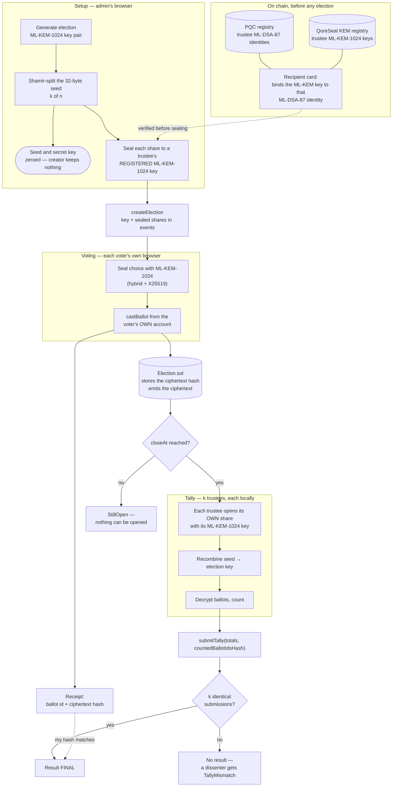

# Booth — a secret ballot that stays secret after Q-Day

**QoreChain "Build Before Q-Day" — Encrypted Apps.**
Live on QoreChain testnet `qorechain-diana`, EVM chain id **9800**.

Registered voters cast ballots that are encrypted **in the browser** with
ML-KEM-1024 and sealed to a panel of trustees. Only ciphertext goes on chain.
Ballots cannot be opened until voting closes, and not unless **k of n** trustees
take part. One registered voter, one vote. Any voter can check their ballot was
counted.

| | |
|---|---|
| Election contract | [`0x8a90db2f3f2192f94a1376c2b51f34f0628b1110`](https://explore.qore.network/address/0x8a90db2f3f2192f94a1376c2b51f34f0628b1110) |
| Election that ran | #5 — hedgehog 3, badger 1, otter 1, 2 of 2 trustees agreeing |
| Transaction record | [PROOF.md](PROOF.md) — 37 rows, every claim with its tx |
| Measured chain facts | [docs/VERIFIED-FACTS.md](docs/VERIFIED-FACTS.md) |
| Design and trust model | [docs/ARCHITECTURE.md](docs/ARCHITECTURE.md) |

---

## The problem

A secret ballot has to keep two promises that pull against each other: nobody
may learn how you voted, and everybody must be able to check the count. Today's
systems keep the first with RSA or elliptic-curve encryption — which a
cryptographically relevant quantum computer breaks retroactively. Ballots
published today as ciphertext are a *harvest-now-decrypt-later* archive: the
tally is already public, but the link from voter to choice becomes readable the
day the maths falls.

Booth's premise is that **ballot secrecy has to outlive the cryptography that
protected it in transit.** So the ciphertext on chain is ML-KEM-1024 (FIPS 203),
the key that opens it never exists in one place while voting is open, and the
identities that authorise everything are ML-DSA-87 (FIPS 204).

## How it works

An election has one ML-KEM-1024 key pair. Ballots seal to its public half.
Its **32-byte seed** is Shamir-split k-of-n and each share is sealed with
QoreSeal to one trustee's *registered* ML-KEM-1024 key, so recovering the
election key needs k trustees. The creator never holds it: the seed is split and
zeroed in the same function that generates it
([`src/core/election.ts`](src/core/election.ts)).

Voting is a window on chain. Each voter seals their choice in their own tab and
submits it themselves — `msg.sender` *is* the voter, so a ballot cannot be cast
in anyone else's name. The contract stores only `keccak256(ciphertext)` and
emits the ciphertext in an event.

After the close, k trustees each open their own share with their own ML-KEM key,
recombine the seed off chain, decrypt the ballots locally and submit **totals**.
A result is final only when k trustees submit byte-identical totals *and* the
same counted-ballot set. No share and no election key ever reaches the chain.



## Category requirements, and what proves each one

Every row points at the code that does it and the **transaction** that shows it
happened. Row numbers are [PROOF.md](PROOF.md) rows.

| Requirement | Where it lives | Proof on chain |
|---|---|---|
| **ML-KEM-1024 encryption** | [`src/core/election.ts`](src/core/election.ts) generates the election ML-KEM-1024 key; [`src/core/electionKey.ts`](src/core/electionKey.ts) publishes it; ballots seal in [`scripts/08-run-election-contract.ts`](scripts/08-run-election-contract.ts) | Row **31** — election 5 created with the ML-KEM-1024 key on chain ([tx](https://explore.qore.network/tx/0x109be8ec2639a7606a458df578084417e53f2af7a219b02ec72634ca692c353f)) · Row **32** — a 1,747-byte sealed ballot ([tx](https://explore.qore.network/tx/0x0e3a3e8d69afe0f1fff95c28ea8530a188ed755e7de3504795ea3d0cb577f908)) |
| **Registered recipient keys** | [`scripts/01-register-keys.mjs`](scripts/01-register-keys.mjs) publishes each trustee's ML-KEM-1024 key via QoreSeal's KEM registry message (`algorithm_id: 2`); `Election.sol` stores only the `keccak256` **reference**, resolved against the registry | Rows **5**, **8**, **10** — the three registrations ([t1](https://explore.qore.network/tx/DE8654D700BD4B2EE499E14F151405DBDC9000E5E83949D5A405773BD5240B1F) · [t2](https://explore.qore.network/tx/1CC7849F02A98D4DA3264C60AF7C2B6B6F1EA705FEB88EC73AB1B800C4D85F1D) · [t3](https://explore.qore.network/tx/1332CCB657DD390A911ECBFFC11FA9549DEAD1B38614EBEB51802342351649B3)) |
| **ML-DSA key binding** | QoreSeal **recipient cards**: `signRecipientCard` binds the X25519 key and the SHA3-256 of the registered ML-KEM key to the account, signed with its ML-DSA-87 key. `verifyRecipientCard` checks it against the account's **on-chain** ML-DSA-87 *and* ML-KEM keys before anything is sealed — [`scripts/01-register-keys.mjs`](scripts/01-register-keys.mjs), re-verified in [`scripts/08`](scripts/08-run-election-contract.ts) | Rows **4**, **7**, **9** — ML-DSA-87 identities registered with proof of possession ([t1](https://explore.qore.network/tx/D0DA08E2C8CAC4019829103D2D7063BD93F99834311C837286E6E1AE7D015816) · [t2](https://explore.qore.network/tx/C4EADFC535CB64EB96C292F1DED59AA16942EE923F610342FCB33FC6BDB8DF85) · [t3](https://explore.qore.network/tx/8AB10F925BB3632A01921F9AE1697DFE855C9086DEFF0568ED706D6338EEC5E8)) |
| **Client-side encryption and decryption** | Sealing: [`src/core/ballot.ts`](src/core/ballot.ts) — no network calls, the plaintext choice never leaves the tab. Opening: [`src/core/tally.ts`](src/core/tally.ts) — trustees recombine and decrypt locally. There is no server anywhere in this repo | Rows **35**, **36** — trustees submit **totals only**; no share or key is ever sent ([t1](https://explore.qore.network/tx/0x2675d3ded15bedd69a8c7683f66233ae73bed4e1f3ac0228bcbd1207aeb314f0) · [t2](https://explore.qore.network/tx/0xd20f42944a2eb3532f46a21264a56fa1e938bdb3e5bfb543d41266e29022c71b)) |

Rules enforced on chain, each with a refused transaction to show it:

| Rule | Error | Proof |
|---|---|---|
| One voter, one ballot | `AlreadyVoted` | Row **33** ([tx](https://explore.qore.network/tx/0x88742d4f16dc25ff90ac766c2fc883044faf615920374df427e9a2199474befb)) |
| Nothing opens before the close | `StillOpen` | Row **34** ([tx](https://explore.qore.network/tx/0x596bb3b89edbd058570425e0d0d2e13f228cedf2e1cd88f613de7b5ab9e1c58d)) |
| A dissenting trustee cannot rewrite a result | `TallyMismatch` | Row **37** ([tx](https://explore.qore.network/tx/0xc8b85a13e727e3af6f41917b82ea79239bfcd98c907f30815d319b15fb57dee2)) |

## We broke our own v1

The first contract, `Booth.sol`, had trustees **reveal their shares on chain**
so that anyone could recompute the tally. It worked, it ran a full election, and
it is a privacy failure.

`revealShare` took each trustee's **plaintext** 33-byte Shamir share as calldata,
wrote it into contract storage and emitted it. We verified the consequence
rather than assuming it: reading `getRevealedShares(2)` straight off the chain
returns those plaintext shares, two of them recombine to the **3,168-byte
election ML-KEM-1024 decapsulation key**, and it matches the `electionKeyHash`
the contract had stored. Because `Booth.BallotCast` also *indexes the voter
address*, anybody can now decrypt every ballot in Booth election 2 **and**
attribute each choice to the voter who cast it.

The three transactions that did it:

- Row **18** — trustee 1 reveals ([tx](https://explore.qore.network/tx/0xbf380cf9a78ba75f0b2a59bbbcee453818a03f62452946d7b212cd06c3b33faf))
- Row **19** — trustee 2 reveals; two shares are now enough ([tx](https://explore.qore.network/tx/0x91c3225769f14e2300dc50e01791c388f8cf1e37a41b11bcf87bfda8faa55831))
- Row **20** — trustee 3 reveals too ([tx](https://explore.qore.network/tx/0x7d4742b1029fbe6e4a7de3f635c3dd8efff3722a2763c1e27faa343199b8c392))

**Booth election 2 has no ballot secrecy and cannot regain it.** Those five
ballots are permanently readable. We left it on chain and wrote it down instead
of quietly deleting it, because the failure is the most useful thing we learned:
*public verifiability bought with published key material is not ballot secrecy.*

`Election.sol` keeps the shares off chain. Trustees decrypt locally and publish
only totals, pinned to a counted-ballot set that k of them must agree on. The
cost is that you can no longer recompute the tally yourself from chain data —
you check that k independent trustees agreed. That is the trade we chose
deliberately, with the alternative sitting in [`legacy/`](legacy/) as evidence.

## Honest limitations

- **k colluding trustees can deanonymise every voter.** Ballot ciphertexts are
  public and `BallotCast` carries the voter's address, so k trustees who
  recombine the key can link each choice to its voter. Booth reduces this to a
  k-of-n collusion assumption; it does not remove it.
- **This is k-of-n key *recovery*, not threshold decryption.** The tallying
  machine briefly holds the reconstructed election key. A real threshold scheme
  never assembles it anywhere.
- **You cannot recompute the tally from chain data.** You verify that k trustees
  agreed on identical totals and an identical counted-ballot set. Trustees who
  all lie the same way would not be caught by the contract.
- **A receipt proves inclusion, not correct counting.** `ballotHash()` shows
  your exact ciphertext is on chain; the counting happens off chain.
- **The admin can censor at registration.** It chooses the allowlist and the
  open/close times. This is public (`VoterAllowed` events, `isVoter()`), so it
  is detectable — but it is not prevented.
- **Trustees can stall indefinitely.** Fewer than k submissions means no result.
  There is no timeout or fallback.
- **No browser UI yet.** The whole flow is driven by scripts. QoreX rejects
  `eth_sendTransaction`, `personal_sign` and `eth_signTypedData_v4` today
  (measured — docs/VERIFIED-FACTS.md), and MetaMask cannot produce the
  hybrid native-lane signature that opening an EVM window requires. So a real
  browser voting path is an open design question, not a finished feature.
- **The contract is not source-verified**, because `explore.qore.network`
  exposes no verification API and Sourcify does not list chain 9800. Instead the
  compiler and settings are pinned and the deployed runtime is checked against
  the Foundry artifact (row 22).
- **Testnet only.** Nothing here has been audited.

## Credits

Booth is mostly other people's cryptography. Nothing cryptographic was
implemented here.

**QoreChain official kits**

| Package | Version | Used for |
|---|---|---|
| [`@qorechain/qoreseal`](https://github.com/qorechain/qoreseal) | 0.1.0 | ML-KEM-1024 sealing, recipient cards, the KEM registry message |
| [`@qorechain/qoresign`](https://github.com/qorechain/qoresign) | 0.2.0 | ML-DSA-87 identities, hybrid signing, proof of possession |
| [`@qorechain/pqc`](https://github.com/qorechain/qorechain-pqc) | 0.2.3 | FIPS 203 / 204 primitives |
| [`@qorechain/sdk`](https://github.com/qorechain/qorechain-sdk) | 0.14.0 | unified accounts, native-lane signing, EVM window messages |
| [`@qorechain/evm`](https://github.com/qorechain/qorechain-sdk) | 0.14.0 | chain definitions, precompile bindings, window helpers |

All Apache-2.0, © QoreChain Association.

**Other libraries**

| Library | Version | Used for |
|---|---|---|
| [`shamir-secret-sharing`](https://github.com/privy-io/shamir-secret-sharing) (Privy) | 0.0.4 | splitting and recombining the 32-byte election seed — the only non-kit cryptographic dependency, Apache-2.0, independently audited, zero-dependency |
| [`viem`](https://viem.sh) | ^2.58.6 | EVM client and ABI encoding |
| [`@cosmjs/stargate`](https://github.com/cosmos/cosmjs) | 0.39.0 | native-lane broadcasting |
| [`solc`](https://soliditylang.org) | 0.8.28 | legacy and probe contracts |
| [`forge-std`](https://github.com/foundry-rs/forge-std) | v1.17.0 | Solidity tests |
| [`vitest`](https://vitest.dev) · [`tsx`](https://tsx.is) · [`typescript`](https://www.typescriptlang.org) | — | tests and tooling |

Built with [Foundry](https://getfoundry.sh) 1.10.0. QoreSeal's ML-KEM is backed
by [`@noble/post-quantum`](https://github.com/paulmillr/noble-post-quantum).
AI assistance is logged in [AI_USAGE.md](AI_USAGE.md), as the rules require.

## Repository layout

```
contracts/Election.sol      the submission — k-of-n trustee tally
legacy/                     Booth.sol, superseded (see "We broke our own v1")
probes/PqcProbe.sol         deployed evidence about the PQC precompile
src/core/                   sealing, k-of-n shares, tally — no network, no DOM
test/solidity/              38 Foundry tests
test/*.test.ts              27 vitest tests, incl. live-EVM contract checks
scripts/                    account setup, registration, deploy, election runs
docs/VERIFIED-FACTS.md      every chain fact, measured, with how
docs/ARCHITECTURE.md        design, trust model, who can censor what
PROOF.md                    37 transactions, each with what it proves
```

## Running it

```bash
npm install
git submodule update --init --recursive   # forge-std
npm test                                  # 27 vitest
forge test                                # 38 Foundry
node scripts/generate-accounts.mjs        # writes .env, prints only addresses
#   fund the printed qor1 address at https://dashboard.qorechain.io/faucet
node scripts/status.mjs                   # preflight: balances, keys, windows
node scripts/01-register-keys.mjs         # trustee ML-DSA-87 + ML-KEM-1024
npx tsx scripts/07-deploy-election.ts     # deploy Election.sol
npx tsx scripts/08-run-election-contract.ts   # one full election
```

Secrets live only in `.env`, which is gitignored. No script ever prints a
mnemonic or a private key.

Apache-2.0.
